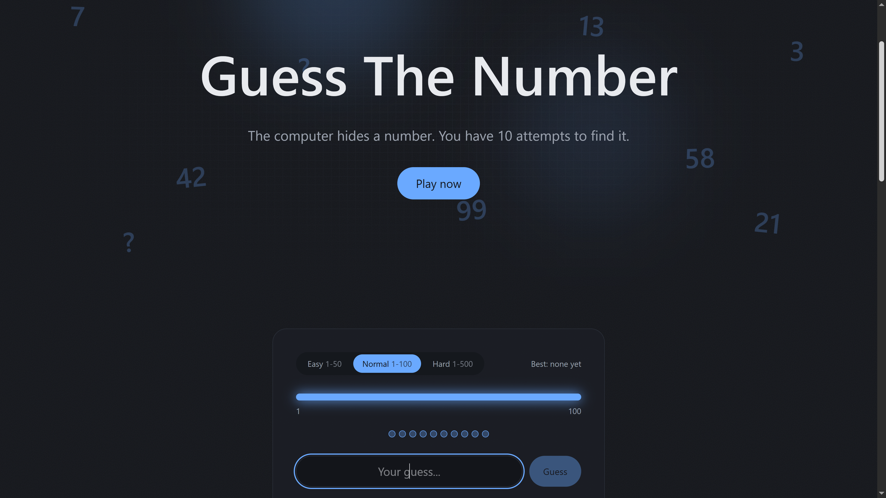

# Guess The Number

A number-guessing game rebuilt with **Next.js, React, TypeScript and Tailwind CSS**. The computer hides a number and you have 10 attempts to find it.

**Live demo:** _add your Vercel link here_



## Features

- Three levels: Easy (1-50), Normal (1-100), Hard (1-500)
- A glowing range bar that narrows after every hint
- Attempt counter, guess history and best score per level (saved in the browser)
- Animations: shake after three misses on the same side, confetti on a win
- Keyboard friendly (Enter to guess), responsive, respects reduced-motion settings
- Game rules in a separate, unit-tested module

## History

This is version 2. The original (plain HTML, CSS and JavaScript) is kept under the tag `v1-legacy`.
Version 2 also fixes a bug where the game never ended after the last attempt.

## Run locally

```bash
npm install
npm run dev     # http://localhost:3000
npm test        # unit tests
npm run build   # production build
```

## Structure

```
lib/game.ts         game rules (judge, validate, range, trend)
lib/game.test.ts    unit tests
components/Game.tsx the game interface
app/page.tsx        landing page
```

## License

MIT
